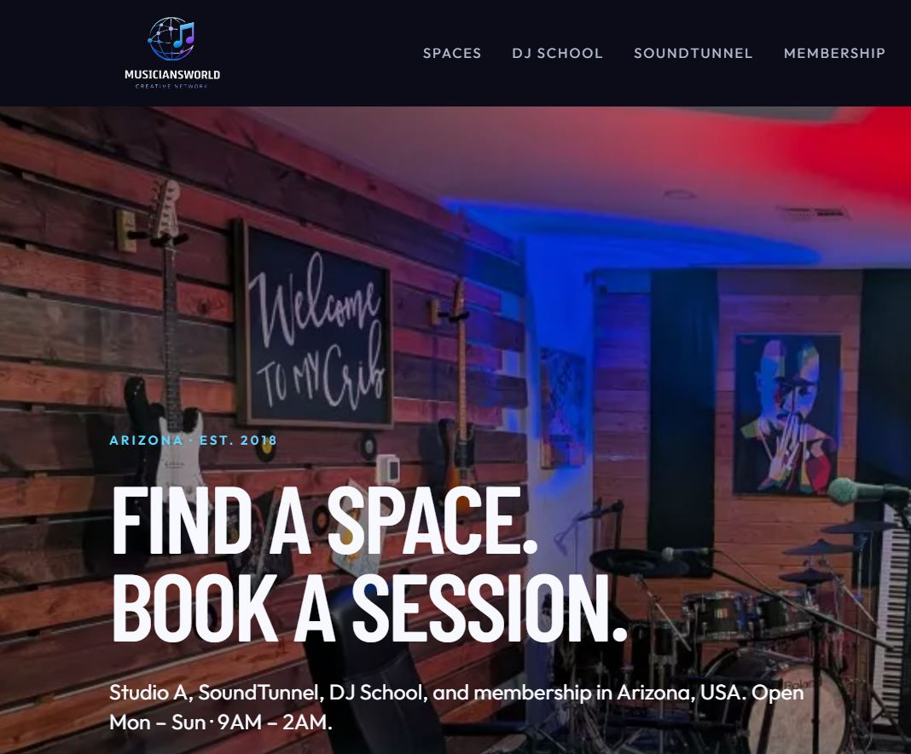
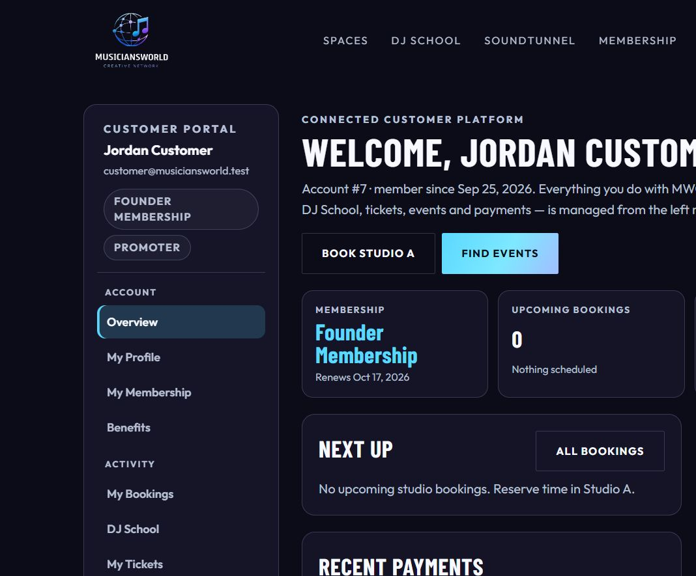
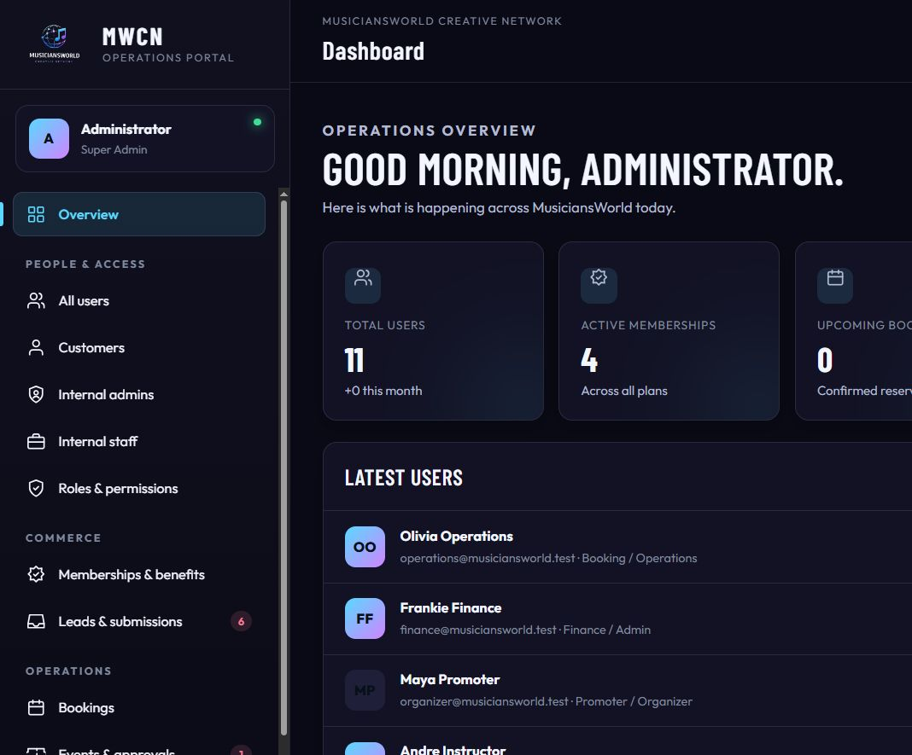
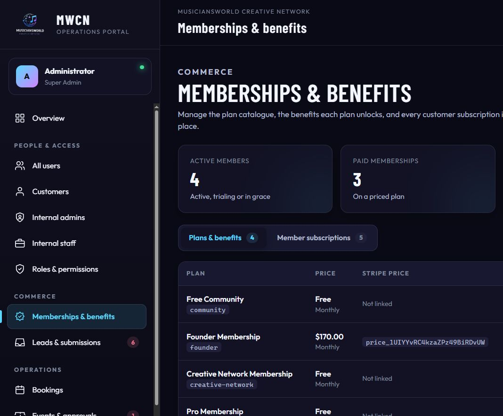
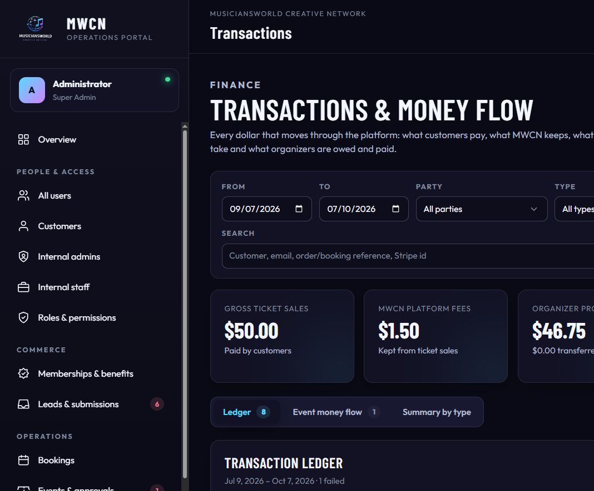

# MusiciansWorld Creative Network

## Client guide — what has been built

This guide explains the system that is live at [https://musiciansworld.wasmer.app](https://musiciansworld.wasmer.app). It is written for the MusiciansWorld team so you can walk a customer, a promoter, or a staff member through every screen without needing a developer in the room.

The product is one connected platform, not a set of separate tools. The public website brings people in. The customer portal is where a member manages their own relationship with the house. The operations portal is the internal CRM: people, memberships, bookings, events, money, and permissions, each limited to the job that person actually does.

Demo accounts are included at the end of the first section so you can sign in as each role. Change these passwords before the site is used with real customers.

---

## 1. The website

**Public site:** [https://musiciansworld.wasmer.app](https://musiciansworld.wasmer.app)

**Customer and promoter sign-in:** [https://musiciansworld.wasmer.app/login](https://musiciansworld.wasmer.app/login)

**Staff and admin sign-in:** [https://musiciansworld.wasmer.app/admin/login](https://musiciansworld.wasmer.app/admin/login)

Customers and promoters never use the admin login. Staff never use the customer login. If someone uses the wrong door, the page tells them which one to use.

The homepage is the front door of the house: Studio A, SoundTunnel, DJ School, and membership, with a booking search (where, when, space, duration) and the hours Mon–Sun, 9AM–2AM.

### Public pages

| Page | Address |
|---|---|
| Home | https://musiciansworld.wasmer.app/ |
| Spaces | https://musiciansworld.wasmer.app/spaces |
| Studio A | https://musiciansworld.wasmer.app/spaces/studio-a |
| Book Studio A | https://musiciansworld.wasmer.app/book |
| DJ lesson request | https://musiciansworld.wasmer.app/book/dj-lesson |
| SoundTunnel | https://musiciansworld.wasmer.app/soundtunnel |
| DJ School | https://musiciansworld.wasmer.app/dj-school |
| Membership | https://musiciansworld.wasmer.app/membership |
| Events calendar | https://musiciansworld.wasmer.app/events |
| About | https://musiciansworld.wasmer.app/about |
| Contact | https://musiciansworld.wasmer.app/contact |
| Create an account | https://musiciansworld.wasmer.app/register |
| Forgot password | https://musiciansworld.wasmer.app/forgot-password |

Studio A can be booked online. SoundTunnel and DJ School are requested through the desk (the forms land in **Leads & submissions** for staff). Membership presents Free Community and Founding Member. Published events appear on the events page; ticket purchase requires a signed-in customer.

---

## 2. Demo accounts

Every role except the Super Admin uses the password **Demo1234**.

### Internal team — sign in at the admin portal

Full address for every staff account: [https://musiciansworld.wasmer.app/admin/login](https://musiciansworld.wasmer.app/admin/login)

| Role | Person | Email | Password |
|---|---|---|---|
| Super Admin | Administrator | admin@musiciansworld.com | Admin1234 |
| Finance | Frankie Finance | finance@musiciansworld.test | Demo1234 |
| Operations | Olivia Operations | operations@musiciansworld.test | Demo1234 |
| Check-in | Casey Check-In | checkin@musiciansworld.test | Demo1234 |
| Instructor | Andre Instructor | instructor@musiciansworld.test | Demo1234 |

After a successful staff sign-in the browser opens [https://musiciansworld.wasmer.app/admin](https://musiciansworld.wasmer.app/admin).

### Customers and the promoter — sign in at the customer portal

Full address for every customer and promoter account: [https://musiciansworld.wasmer.app/login](https://musiciansworld.wasmer.app/login)

| Role | Person | Email | Password | What you will see |
|---|---|---|---|---|
| Customer and promoter | Jordan Customer | customer@musiciansworld.test | Demo1234 | Founder member who also hosts events |
| Promoter | Maya Promoter | organizer@musiciansworld.test | Demo1234 | Promoter workspace and hosted events |
| Customer | Taylor Reed | taylor.reed@example.test | Demo1234 | Founder membership, active |
| Customer | Morgan Lee | morgan.lee@example.test | Demo1234 | Community membership, trialing |
| Customer | Avery Brooks | avery.brooks@example.test | Demo1234 | Founder membership, in a grace period |
| Customer | Sam Rivera | sam.rivera@example.test | Demo1234 | Community membership, cancelled. This account is marked inactive, so sign-in may be refused until a Super Admin sets it back to active |

After a successful customer sign-in the browser opens [https://musiciansworld.wasmer.app/account](https://musiciansworld.wasmer.app/account).

These are demonstration records. They exist so you can click through every role. They are not real customers.

### A note on the live sign-in

The public website loads. Signing in on the live address currently fails because the hosting database user is not permitted to use the application database. Until that permission is corrected, the accounts above cannot open the portals on the live site. The screenshots later in this guide are the real portals, taken from the working application, so you can see exactly what each role gets.

---

## 3. What “one CRM” means here

Every person is one user record. A role decides which door they use and which menu they see. The same person can be a customer and a promoter (Jordan is the example): one login, and the left menu grows a promoter section because they host events.

Nothing is deleted when a plan is cancelled, a booking is changed, or an event is rejected. History stays on the account: membership periods, receipts, tickets, and an internal audit of staff changes.

Money is one ledger. A ticket sale writes the same numbers for the customer (their receipt), the promoter (their event statement), and finance (the transactions desk). There is not a separate spreadsheet for each side.

---

## 4. Customer portal

Sign-in: [https://musiciansworld.wasmer.app/login](https://musiciansworld.wasmer.app/login)

Home after sign-in: [https://musiciansworld.wasmer.app/account](https://musiciansworld.wasmer.app/account)

The portal is a left sidebar. The person, their membership, and a Promoter badge (when they host) sit at the top. Every section is its own page. On a phone the sidebar becomes a row of buttons so the content is not squeezed off the screen.

### Overview

[https://musiciansworld.wasmer.app/account](https://musiciansworld.wasmer.app/account)

A welcome with the account number and the date they joined. Four summary cards: current plan and renewal date, upcoming studio bookings, upcoming tickets, and total paid. Below that: the next booking, their tickets, recent payments, and — if they host — a promoter workspace with a link to My Events and Host an event. Shortcuts go straight to Book Studio A and Find events.

### My Profile

[https://musiciansworld.wasmer.app/account/profile](https://musiciansworld.wasmer.app/account/profile)

Name, phone, city, state, and postal code. Communication preferences (booking updates, event updates, school updates, and any preference already stored on the account) can be changed here. Saving does not wipe preferences the screen does not show.

### My Membership

[https://musiciansworld.wasmer.app/account/membership](https://musiciansworld.wasmer.app/account/membership)

The current plan, price, status, renewal or end date, how they are billed, and the date they became a member. Billing is written in plain language (“Card on file, billed automatically through Stripe”). Internal billing codes are not shown to the customer.

A paid member can schedule cancellation at the end of the period they already paid for. They keep every benefit until that date, then the account returns to the free Community tier. Nothing is deleted. A banner explains the end date and offers **Keep my membership** if they change their mind. The free Community plan cannot be cancelled; it stays with the account.

Other plans are listed beside the current one, with a link to compare or upgrade on the public membership page. A history table shows every membership period, status, and price.

### Benefits

[https://musiciansworld.wasmer.app/account/benefits](https://musiciansworld.wasmer.app/account/benefits)

What the current plan actually unlocks, including the promoter platform fee for their tier. This is the customer-facing view of the same benefit catalogue staff edit in the operations portal.

### My Bookings

[https://musiciansworld.wasmer.app/account/bookings](https://musiciansworld.wasmer.app/account/bookings)

Studio and rental bookings that belong to this person: space, date and time in Arizona time, status, and amount. From a booking they can send a change request to the desk. Staff see that request on the bookings desk; the customer does not edit the booking themselves.

### DJ School

[https://musiciansworld.wasmer.app/account/dj-school](https://musiciansworld.wasmer.app/account/dj-school)

Programs and lessons this person is enrolled in or has requested. New interest submitted from the public DJ School page arrives for staff as a lead; once they are enrolled, it shows here.

### My Tickets

[https://musiciansworld.wasmer.app/account/tickets](https://musiciansworld.wasmer.app/account/tickets)

Tickets they bought: event, ticket type, status, and a QR code for the door. The QR is private to the ticket holder and to staff who are allowed to check people in.

### My Events

[https://musiciansworld.wasmer.app/account/events](https://musiciansworld.wasmer.app/account/events)

This is the promoter list. It is empty for a customer who has never hosted. Filters narrow the list to draft, pending, published, or completed. Each event shows its status and, once there are sales, the money statement: what customers paid, the MWCN fee, refunds, and what the organizer is owed.

Open one event for the full statement, the orders, how many tickets were issued and checked in, and the ledger lines for that night.

### Payments & Receipts

[https://musiciansworld.wasmer.app/account/payments](https://musiciansworld.wasmer.app/account/payments)

Every charge and refund on the account. Filters: All, Tickets, Bookings, Memberships, Refunds. Each row has a date, an MWCN receipt number (for example MWCN-000001), a plain description, a type, the booking or order reference (for example DEMO-BKG-1001 or DEMO-ORD-3001), a status, and the amount. Ticket rows also show the split: ticket total, MWCN fee, organizer share.

Open a receipt to print it. The receipt names the account, the description, the reference, how it was paid (“Card, processed by Stripe”), and the line items. Internal ledger rows (the fee and the organizer’s share as separate accounting lines) are not listed as if the customer was charged three times.

### Host an event

[https://musiciansworld.wasmer.app/host-an-event](https://musiciansworld.wasmer.app/host-an-event)

Any signed-in member can start an event. The form asks for title, category, location (SoundTunnel at MusiciansWorld, another venue, or online), description, and schedule. Date and time fields open a calendar. Times are Arizona time (MST). Choosing a start time fills the end four hours later and doors one hour earlier when those fields are empty. The customer adds ticket types (name, price, quantity, per-order limit; price 0 is a free RSVP) and optional SoundTunnel services.

**Save draft** stores the event. **Submit for review** sends it to MWCN. It cannot be submitted with no ticket type, or with a start time that has already passed. Once it is submitted, the form locks so the desk is reviewing a stable copy. The promoter can still open Sales & transactions for that event.

---

## 5. How a night of tickets moves through the CRM

1. A promoter saves a draft and submits it.
2. Operations (or a Super Admin) reviews it on Events & approvals: approve and publish, ask for changes, or reject.
3. A published event appears on [https://musiciansworld.wasmer.app/events](https://musiciansworld.wasmer.app/events).
4. A signed-in customer buys a ticket. The order is paid through Stripe when live keys are connected.
5. The ledger records, for that order:
   - what the customer paid (gross ticket sales),
   - the MWCN platform fee,
   - payment processing,
   - the organizer’s proceeds.
6. The customer sees the receipt. The promoter sees the same split on the event. Finance sees the same lines on Transactions.
7. After the event, finance calculates the settlement, then records the transfer to the organizer.

The platform fee is a setting, not a hardcoded guess. The seeded tiers are **3% for Founder** and **5% for Community**. A $50 ticket at 3% keeps $1.50 at MWCN and leaves the rest, after any processing and refunds, with the organizer. Refunds are their own lines and show as money returned.

---

## 6. Operations portal

Sign-in: [https://musiciansworld.wasmer.app/admin/login](https://musiciansworld.wasmer.app/admin/login)

This is the internal CRM. The left menu only shows what that person’s role is allowed to open. A light/dark switch sits in the top bar. Wide tables stay inside the page and scroll sideways instead of running off the edge. Edit screens open as centered popups, so staff can change a plan, a booking, or a user without leaving the list.

The menu, when the role is allowed to see it, is:

**People & access** — All users, Customers, Internal admins, Internal staff, Roles & permissions

**Commerce** — Memberships & benefits, Leads & submissions

**Operations** — Bookings, Events & approvals

**Finance & configuration** — Transactions, Reports, Settings

Two tools are deliberately not in the menu. They are still there for the roles that need them:

- Failed integration jobs: [https://musiciansworld.wasmer.app/admin/failures](https://musiciansworld.wasmer.app/admin/failures)
- Audit history: [https://musiciansworld.wasmer.app/admin/audit](https://musiciansworld.wasmer.app/admin/audit)

### Overview

[https://musiciansworld.wasmer.app/admin](https://musiciansworld.wasmer.app/admin)

A greeting, then the numbers that matter today: total users, active memberships, upcoming bookings, and the rest of the operations snapshot. Under that: the latest users, the latest inquiries, recent bookings, quick actions (staff, roles, event review, memberships), system health, and the event approval queue. Badges on the menu show how many leads are new and how many events are waiting for review.

### All users, Customers, Internal admins, Internal staff

| List | Address |
|---|---|
| All users | https://musiciansworld.wasmer.app/admin/users |
| Customers | https://musiciansworld.wasmer.app/admin/customers |
| Internal admins | https://musiciansworld.wasmer.app/admin/admins |
| Internal staff | https://musiciansworld.wasmer.app/admin/staff |

Same screen, filtered. Search by name or email. Open a person for their profile, memberships, bookings, tickets, transactions, roles, and direct permissions. A Super Admin can create a staff account, change status, reset a password, and assign roles. Customers are created from the public registration page or by staff; they are not given the admin door.

### Roles & permissions

[https://musiciansworld.wasmer.app/admin/roles](https://musiciansworld.wasmer.app/admin/roles)

Super Admin only. Each role is a set of permissions. Changing a role changes what every person with that role can see, without editing them one by one. A person can also be given an extra permission on their own profile when one job needs an exception.

### Memberships & benefits

[https://musiciansworld.wasmer.app/admin/memberships](https://musiciansworld.wasmer.app/admin/memberships)

Super Admin only (the permission required is “configure plans,” not merely “view memberships”).

Two tabs.

**Plans & benefits** lists every plan: name, price, billing interval, Stripe price link, the benefits attached, how many members are on it, whether it is visible, and display order. **New plan** and the edit popup set the price, the interval, the Stripe price id, the description, whether customers can see it, and the value of each benefit (studio minutes, promoter fee, studio discount). A benefit left blank is not included on that plan.

The benefit catalogue under the plans is the master list of benefits the platform understands. Plan editors assign values; this table shows the value on every plan side by side.

**Member subscriptions** is every customer’s subscription: who, which plan, status (active, trialing, grace, past due, cancelled, expired), the current period, grace or cancellation dates, and Stripe ids for the desk. **Assign membership** attaches a plan to a customer. Edit changes plan, status, and period. Cancelling here is an administrative correction. The customer-facing cancel button only schedules the end of the paid period.

Seeded plans include Free Community, Founder Membership ($170.00 per month in the current demo catalogue; the public page also describes the $150 founding offer), Creative Network Membership, and Pro Membership. Prices and visibility are edited here, not in code.

### Leads & submissions

[https://musiciansworld.wasmer.app/admin/leads.php](https://musiciansworld.wasmer.app/admin/leads.php)

Contact, SoundTunnel rental, and DJ School inquiries. Each row has a type, a person, a message, and a status. Staff update the status as the desk works the lead. The menu badge is the count of leads still marked new.

### Bookings

[https://musiciansworld.wasmer.app/admin/bookings](https://musiciansworld.wasmer.app/admin/bookings)

The studio desk. Filter by status, space, and date. Each booking shows the customer, the room, the start and end in Arizona time, the price, and the payment state. The edit popup updates status and payment. Operations can change bookings. Finance can read them.

Availability blocks (a room held for maintenance or a private hold) are managed under Settings → Availability by anyone allowed to manage bookings.

### Events & approvals

[https://musiciansworld.wasmer.app/admin/events](https://musiciansworld.wasmer.app/admin/events)

Every event, not only the ones waiting. The edit popup covers the public details, the review decision (approve, request changes, reject, publish, suspend, complete), and the settlement. Review notes go back to the promoter. Finance can open this list and can calculate a settlement and record a transfer. Operations can review and publish. Check-in staff can open the list so they know what is on tonight; they do not approve events.

Check-in itself is a door link on the ticket, limited to Check-in, Operations, and Super Admin.

### Transactions

[https://musiciansworld.wasmer.app/admin/transactions](https://musiciansworld.wasmer.app/admin/transactions)

Finance and Super Admin. This is the money desk.

Filters: date range, party (customer payments, MWCN revenue, organizer proceeds and payouts, processing fees), type, status, event, and a search across customer, email, reference, and Stripe id. **Export CSV** downloads the filtered ledger.

Summary cards for the selected period: gross ticket sales, MWCN platform fees, organizer proceeds, and the related totals (refunds, processing, what has actually been transferred).

Three tabs:

- **Ledger** — every line, who it belongs to, the type, the reference, the status, and the amount. Internal lines and customer payments are both here, because finance needs both.
- **Event money flow** — one statement per event: customer paid, fee, processing, refunds, organizer proceeds, payout status.
- **Summary by type** — totals grouped by transaction type for the period.

### Reports

[https://musiciansworld.wasmer.app/admin/reports](https://musiciansworld.wasmer.app/admin/reports)

Operational and financial reporting for Finance and Super Admin. Export is a separate permission, so a person can be allowed to look without being allowed to download.

### Settings

[https://musiciansworld.wasmer.app/admin/settings](https://musiciansworld.wasmer.app/admin/settings)

The hub, platform values, room pricing, and integrations are Super Admin. Availability is also open to Operations, because holding a room is part of running the desk. Four areas:

| Area | Address | What it controls |
|---|---|---|
| Hub | https://musiciansworld.wasmer.app/admin/settings | Entry point |
| Platform | https://musiciansworld.wasmer.app/admin/settings/platform | Fees, feature flags, and other platform values, including the promoter fee in basis points |
| Pricing | https://musiciansworld.wasmer.app/admin/settings/pricing | Rooms and the price rules for Studio A |
| Availability | https://musiciansworld.wasmer.app/admin/settings/availability | Holds that block a room |
| Integrations | https://musiciansworld.wasmer.app/admin/settings/integrations | Stripe, mail, and calendar connection status |

---

## 7. What each role’s dashboard actually contains

The sidebar is the dashboard. If a link is not in this list, that person does not see it and cannot open it by typing the address.

### Super Admin — Administrator

Sign in: [https://musiciansworld.wasmer.app/admin/login](https://musiciansworld.wasmer.app/admin/login)

Sees and can change everything in the operations portal: overview, all four user lists, roles, memberships, leads, bookings, events (including approval), transactions, reports and export, settings, failed jobs, and the audit log. This is the only role that should create other staff and change who is allowed to do what.

### Finance — Frankie Finance

Sign in: [https://musiciansworld.wasmer.app/admin/login](https://musiciansworld.wasmer.app/admin/login)

Overview, all four user lists (view), bookings (view), events (view, plus settlement calculate and transfer), transactions, reports, export, and the audit log. Frankie does not edit plans, does not assign roles, does not work the lead inbox, and does not change platform settings. The job is to see people, read the studio calendar, and own the money.

### Operations — Olivia Operations

Sign in: [https://musiciansworld.wasmer.app/admin/login](https://musiciansworld.wasmer.app/admin/login)

Overview, user lists (view), leads (view and update), bookings (view and update), events (view and approve), ticket check-in, and failed integration jobs. Olivia runs the desk: rooms, the night’s approval, and the door. Olivia does not see Transactions, Reports, the settings hub, or Roles. She can hold a room from Availability: [https://musiciansworld.wasmer.app/admin/settings/availability](https://musiciansworld.wasmer.app/admin/settings/availability).

### Check-in — Casey Check-In

Sign in: [https://musiciansworld.wasmer.app/admin/login](https://musiciansworld.wasmer.app/admin/login)

Overview, the events list, and ticket check-in. Casey can confirm who is coming and scan a ticket. Casey cannot change a booking, approve an event, or see money.

### Instructor — Andre Instructor

Sign in: [https://musiciansworld.wasmer.app/admin/login](https://musiciansworld.wasmer.app/admin/login)

Overview only. Andre can see the operations snapshot. Student records and enrollments are not a separate instructor workspace yet; DJ School requests are handled by Operations through Leads, and a student’s own lessons appear in their customer portal.

### Promoter — Maya Promoter

Sign in: [https://musiciansworld.wasmer.app/login](https://musiciansworld.wasmer.app/login)

Maya uses the customer portal, not the admin portal. She gets every customer section plus My Events and Host an event. She creates the night, sets tickets, submits it, and later reads the sales statement. She cannot approve her own event and she cannot see other promoters’ money.

### Customer — Jordan, Taylor, Morgan, Avery, Sam

Sign in: [https://musiciansworld.wasmer.app/login](https://musiciansworld.wasmer.app/login)

Overview, Profile, Membership, Benefits, Bookings, DJ School, Tickets, and Payments. My Events appears in the menu for everyone; it only fills up when that person hosts. A customer cannot open another customer’s receipt, another promoter’s event, or any admin address.

---

## 8. What still needs the client’s live accounts

The CRM is built and the demo data proves each path. These connections are ready in settings and are not switched to production until you provide the real accounts:

- **Stripe** — publishable key, secret key, webhook secret, and the Founding Member price id. Until these are the live values, checkout and subscription billing stay in demonstration mode.
- **Email** — the sending mailbox (the from-address is booking@wavemakerconcepts.com). Password reset, verification, and booking mail need a production mail account.
- **Microsoft calendar** — tenant, client id, client secret, and the Studio A and SoundTunnel calendar mailboxes, so confirmed bookings can land on the house calendar.
- **Phone number** — the public site still shows “[PHONE — PENDING CLIENT CONFIRMATION]” wherever the desk phone is printed.
- **Database permission on the host** — the live sign-in cannot open until the hosting database user is allowed to use the application database. The public pages do not need that fix; the portals do.
- **Passwords** — replace Admin1234 and Demo1234 before anyone outside the project uses the site.

---

## 9. A short tour you can give in the room

1. Open [https://musiciansworld.wasmer.app](https://musiciansworld.wasmer.app) and walk Home, Spaces, Membership, and Events.
2. Sign in as Jordan at [https://musiciansworld.wasmer.app/login](https://musiciansworld.wasmer.app/login) and click every item in the left menu, then open a receipt.
3. Sign out. Sign in as Maya at the same customer login and open My Events, then Host an event, and show the calendar and the ticket rows.
4. Sign out. Sign in as Administrator at [https://musiciansworld.wasmer.app/admin/login](https://musiciansworld.wasmer.app/admin/login). Show Overview, then Memberships, then Events, then Transactions.
5. Sign out and sign in as Frankie, Olivia, and Casey, one after another, and point at the menu. The missing items are the point: each person sees their job and not the rest of the building.
